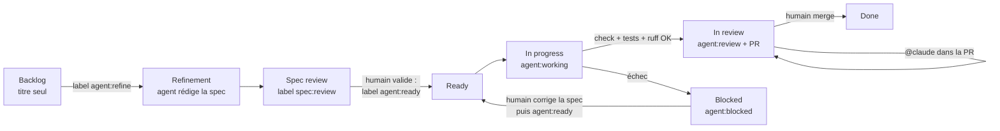

# Workflow agentique : des issues au board, du ticket à la PR

Les issues GitHub servent de specs. Un agent Claude (via
[`anthropics/claude-code-action`](https://github.com/anthropics/claude-code-action))
les transforme en spécifications, les implémente une par une et ouvre une pull
request. **Rien n'est mergé sans validation humaine.**

Même fonctionnement que sur `angular-ssr-taiwan` et `angular-qrcode-restaurant`,
adapté à Django (voir la dernière section).

## Cycle de vie d'un ticket

| Étape                 | Qui     | Déclencheur                                                                              | Ce qui se passe                                                                                                                                                                                                                                                                                                                                                                                                                                                     |
| --------------------- | ------- | ---------------------------------------------------------------------------------------- | ------------------------------------------------------------------------------------------------------------------------------------------------------------------------------------------------------------------------------------------------------------------------------------------------------------------------------------------------------------------------------------------------------------------------------------------------------------------- |
| Raffinement           | Agent   | label `agent:refine` (ou lancement manuel sur une liste d'issues / une épic entière)     | L'agent lit le ticket, l'épic parente, les tickets voisins et le code, puis remplace le corps de l'issue par une spec (contexte, critères d'acceptation, impact technique dont migrations et API, plan de test, hors périmètre, questions ouvertes, estimation). Label → `spec:review`.                                                                                                                                                                             |
| Validation de la spec | **Toi** | —                                                                                        | Tu relis, corriges le corps de l'issue, tranches les questions ouvertes, puis poses `agent:ready`.                                                                                                                                                                                                                                                                                                                                                                  |
| Implémentation        | Agent   | label `agent:ready`, lancement manuel, ou toutes les 3 h (prochain ticket `agent:ready`) | Un ticket à la fois. Branche `agent/issue-<n>-<slug>`, implémentation + migrations + tests Django, puis vérification dans le navigateur (Playwright MCP sur l'app lancée avec `runserver`, base SQLite jetable et données de démo, captures jointes à la PR), puis par le workflow (`manage.py check`, `manage.py test`, Ruff sur les fichiers modifiés). PR ouverte sur `master` avec `Closes #n`, revue demandée à la propriétaire du dépôt. Label → `agent:review`. Si une vérification échoue : PR **brouillon** + `agent:blocked`. |
| Revue                 | **Toi** | —                                                                                        | Tu relis la PR. Pour des corrections, commente `@claude …` (commentaire général, de ligne ou de revue) : l'agent pousse sur la même branche.                                                                                                                                                                                                                                                                                                                        |
| Validation            | **Toi** | merge                                                                                    | La PR ferme l'issue → `Done`.                                                                                                                                                                                                                                                                                                                                                                                                                                       |

Garde-fous :

- Les épics (issues avec sous-tickets) ne sont jamais implémentées directement :
  pose `agent:ready` sur leurs sous-tickets.
- Un ticket `agent:ready` sans section « Critères d'acceptation » repart
  automatiquement en raffinement.
- L'agent ne voit que le ticket, l'épic et les commentaires des mainteneurs
  (le dépôt est public : les commentaires de tiers sont écartés pour éviter
  l'injection de prompt). Il n'a accès ni au réseau ni à `gh` ; il ne peut
  lancer que `manage.py check / test / makemigrations / migrate /
  showmigrations / sqlmigrate`, Ruff et quelques commandes git en lecture, et
  le navigateur ne peut ouvrir que l'app locale (`http://localhost:8000`).
- L'app de l'agent tourne sur une base SQLite jetable dans `.agent-out/`
  (ignoré par git), jamais sur Postgres ni sur des données réelles. Les comptes
  de démo (`demo-teacher` / `demo-student`, mot de passe `demo-password-123`)
  sont créés par `manage.py seed_demo`, qui refuse de tourner sans `DEBUG`.
- Toute modification de `.github/` par l'agent est annulée avant le commit, et
  c'est le workflow, pas l'agent, qui commit, pousse et ouvre la PR.

## Le board

`agent-board.yml` range chaque issue dans une colonne du champ **Status** de
ton GitHub Project selon ses labels :

| Label / état    | Colonne (noms acceptés)                                          |
| --------------- | ---------------------------------------------------------------- |
| aucun           | Backlog / Todo (uniquement si la carte n'a pas encore de statut) |
| `agent:refine`  | Refinement                                                       |
| `spec:review`   | Spec review                                                      |
| `agent:ready`   | Ready                                                            |
| `agent:working` | In progress                                                      |
| `agent:review`  | In review                                                        |
| `agent:blocked` | Blocked                                                          |
| fermée          | Done                                                             |

Un déplacement manuel d'une carte sans label agent n'est jamais écrasé. Si une
colonne n'existe pas, la carte reste où elle est (un avertissement est loggé).
Le premier lancement manuel importe tout le backlog existant dans le board.

## Installation (une fois)

1. **App Claude GitHub** : installe <https://github.com/apps/claude> sur ce
   dépôt (ou lance `/install-github-app` dans Claude Code).
2. **Environnement `claude`** : les secrets et variables ci-dessous vivent dans
   l'environnement GitHub `claude` (_Settings → Environments → claude_), pas au
   niveau du dépôt. Les jobs qui les lisent déclarent `environment: claude`.
   Ajoute-y le secret `CLAUDE_CODE_OAUTH_TOKEN` (abonnement Claude, généré
   avec `claude setup-token`).
3. **PR créées par Actions** : _Settings → Actions → General → Workflow
   permissions_ → coche **Allow GitHub Actions to create and approve pull
   requests**.
4. **Labels** : `GH_REPO=delitamakanda/elearning bash scripts/agent/setup-labels.sh`
5. **Board** :
   - Crée un GitHub Project (ou réutilise un existant) et ajoute au champ
     **Status** les colonnes : `Backlog`, `Refinement`, `Spec review`, `Ready`,
     `In progress`, `In review`, `Blocked`, `Done`.
   - Enregistre un PAT classique (scopes `repo` et `project`) dans le secret
     `AGENT_PROJECT_TOKEN` — le même que pour tes autres dépôts convient.
   - Ajoute la variable `AGENT_PROJECT_NUMBER` (le numéro dans l'URL du projet,
     `…/users/delitamakanda/projects/<n>`). `AGENT_PROJECT_OWNER` est
     facultative (par défaut : le propriétaire du dépôt).
   - Lance _Actions → Agent – board → Run workflow_ (d'abord avec `dry_run`)
     pour importer toutes les issues.
6. **Modèle** (facultatif) : variable `AGENT_MODEL` (`sonnet` par défaut,
   `opus` pour des tickets plus complexes).

## Utilisation au quotidien

- Raffiner une épic entière : _Actions → Agent – raffinement → Run workflow_,
  champ `epic` = numéro de l'épic, ou champ `issues` = liste (ex. `8,9,10`).
- Implémenter un ticket précis tout de suite : _Actions → Agent –
  implémentation → Run workflow_, champ `issue`.
- Débloquer un ticket `agent:blocked` : corrige la spec ou la PR, retire
  `agent:blocked` et repose `agent:ready`.

## Fichiers

| Fichier                                           | Rôle                                                        |
| ------------------------------------------------- | ----------------------------------------------------------- |
| `.github/workflows/agent-refine.yml`              | Raffinement des tickets en specs                            |
| `.github/workflows/agent-implement.yml`           | Implémentation + PR                                         |
| `.github/workflows/agent-review.yml`              | Retours de revue via `@claude`                              |
| `.github/workflows/agent-board.yml`               | Synchronisation du board                                    |
| `.github/workflows/django.yml`                    | CI : check + tests (+ Ruff sur les fichiers modifiés)       |
| `.github/agent/prompts/*.md`                      | Instructions des agents (à ajuster librement)               |
| `.github/agent/mcp.json`                          | Navigateur Playwright MCP (app locale uniquement)           |
| `.github/ISSUE_TEMPLATE/spec.yml`                 | Formulaire d'issue au format spec                           |
| `scripts/agent/prepare-issue.mjs`                 | Contexte du ticket fourni à l'agent                         |
| `scripts/agent/board-sync.mjs`                    | Labels → colonnes du GitHub Project                         |
| `scripts/agent/setup-labels.sh`                   | Création des labels                                         |
| `scripts/agent/start-app.sh`                      | SQLite jetable + `seed_demo` + `runserver` pour l'agent     |
| `scripts/agent/lint-changed.sh`                   | Ruff sur les seuls fichiers Python modifiés                 |
| `apps/courses/management/commands/seed_demo.py`   | Données de démo (comptes, cours, modules, quiz)             |

## Différences avec les dépôts Angular

- Stack Python : les vérifications sont `manage.py check`, `manage.py test`
  et Ruff (au lieu de `ng lint` / `ng test` / `ng build` / Prettier).
- Pas d'API mock : l'agent travaille sur une vraie app Django, avec une base
  SQLite jetable remplie par `seed_demo`. Redis et Celery ne tournent pas ;
  le cache est factice et les e-mails partent dans les logs.
- Navigateur en 1280×800 par défaut (l'agent passe en 390×844 pour les tickets
  de mise en page).
- Les migrations sont un sujet de revue à part entière : la PR a une section
  `## Migrations`, et `makemigrations --check` est remonté en avertissement
  (non bloquant) tant que la dérive existante sur `master` n'est pas corrigée
  (voir `CLAUDE.md`, « Known issues »).
- La branche par défaut est `master`.
